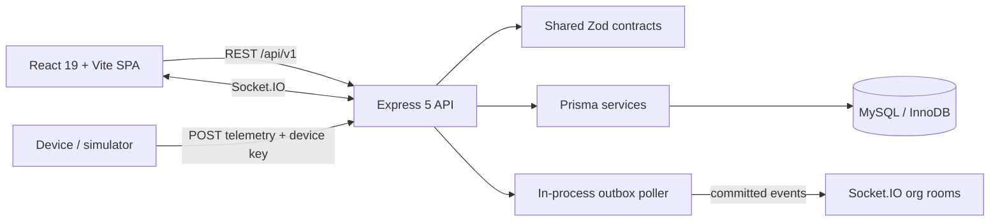

# FROSTGUARD Architecture

**Audit date:** 2026-10-31

## Existing implementation

The project is a TypeScript npm-workspaces monorepo. The source-of-truth architecture inventory, request pipeline and diagrams are in [the existing architecture overview](../ARCHITECTURE.md); this file records the audit interpretation and links the actual technology boundaries.

## Source boundaries

| Layer | Existing implementation | Responsibility |
| --- | --- | --- |
| Web | `apps/web/src` | Public landing, authenticated SPA, route permission gates, React Query, charts, shipment map and Socket.IO client. |
| API | `apps/api/src` | HTTP security middleware, auth/RBAC, domain routers and services, telemetry simulator, reports, socket server and outbox poller. |
| Shared contracts | `packages/shared/src/index.ts` | Roles, permissions, enums and Zod request/response schemas used across web/API. |
| Data model | `apps/api/prisma/schema.prisma` | Normalized MySQL entities and Prisma relations. |
| SQL objects | `database/sql` | Views, integrity triggers, routines, constraints and targeted indexes. |
| Tests | `apps/api/tests` | Vitest/Supertest integration checks against a disposable real MySQL schema. |

## Runtime status

- Local validation on this revision: typecheck, lint, production build, **74 MySQL integration tests** and **5 Playwright tests** passed. All five Prisma migrations and SQL controls applied to a fresh disposable MySQL database.
- GitHub Actions includes clean-schema migrations/SQL, build, test and browser checks. Verify the exact pushed revision in the [workflow history](https://github.com/karkalashivareddy/cold-chain-monitoring-system/actions/workflows/ci.yml).
- API/web Dockerfiles, Docker Compose and Nginx configuration exist. Compose configuration parses, but local image/runtime verification is unavailable because the Docker Engine is not running.
- API and web are separate local processes; the API can serve `apps/web/dist` if it exists.
- The outbox poller and simulator run in the API process. Outbox database claims use `FOR UPDATE SKIP LOCKED`, expiring leases and token-fenced acknowledgement, but Socket.IO fanout remains process-local and failed-event replay tooling is not implemented.
- The direct SQL-applier command required a temporary Windows `os.userInfo` preload after Node returned `uv_os_get_passwd ENOMEM`; the workaround was removed. The regular integration suite passed without a repository shim.
- Browser checks cover the landing at five viewports, the live dashboard, fleet map, product create/edit/archive, and authenticated route smoke. Automated axe checks are included in the documented scope; there has been no independent screen-reader audit.
- REST route prefix is `/api/v1`; the device ingestion path is `POST /api/v1/telemetry/readings`.

## Architecture decisions and limitations

The project keeps its existing React/Express/Prisma/MySQL stack. Prisma handles typical CRUD/relations; parameterized SQL and stored procedures are used for aggregates, query plans, locks and stock reservation. Business operations remain in services rather than React or route handlers.

Organization context is derived from current server-side membership for user requests. Device requests use device identity and a per-device key. Socket connections authenticate the access token and join the organization room from token claims after a membership lookup; client-selected organization IDs are not used to select the room.

The browser resolves shared contracts from packages/shared/src so the CommonJS output used by the Node API is not imported as browser ESM. Product and batch temperature profile IDs are checked against the active organization inside their write transactions.

Telemetry serializes writes per sensor, rechecks credential/status under the row lock, and reads the active assignment inside the transaction. Delayed lower-sequence readings remain immutable history and cannot alter live excursion/alert state. Simulator provenance is derived from the trusted internal ingestion path.

The outbox uses short MySQL row-locking claims with `SKIP LOCKED`, expiring leases and claim-token-fenced acknowledgements, so multiple pollers do not claim the same due row. Delivery is at-least-once: a crash after Socket.IO emit and before acknowledgement can produce a duplicate. Socket.IO uses its in-memory adapter, so rooms do not fan out across API instances; horizontal API operation still needs a shared adapter and deployment-level routing. Failed rows have no authorized replay interface yet and require operational recovery tooling.

## Related design records

- [Database design](../database/DATABASE_DESIGN.md)
- [ER diagram](../database/ER_DIAGRAM.md)
- [Index strategy](../database/INDEX_STRATEGY.md)
- [Transaction design](../database/TRANSACTION_DESIGN.md)
- [Threat model](../security/THREAT_MODEL.md)
