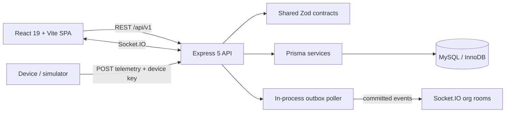

# FROSTGUARD Architecture

**Audit date:** 2026-10-30

## Existing implementation

The project is a TypeScript npm-workspaces monorepo. The source-of-truth architecture inventory, request pipeline and diagrams are in [the existing architecture overview](../ARCHITECTURE.md); this file records the audit interpretation and links the actual technology boundaries.

## Source boundaries

| Layer | Existing implementation | Responsibility |
| --- | --- | --- |
| Web | `apps/web/src` | Public landing, authenticated SPA, route permission gates, React Query, charts, shipment map and Socket.IO client. |
| API | `apps/api/src` | HTTP security middleware, auth/RBAC, domain routers and services, telemetry simulator, reports, socket server and outbox poller. |
| Shared contracts | `packages/shared/src/index.ts` | Roles, permissions, enums and Zod request/response schemas used across web/API. |
| Data model | `apps/api/prisma/schema.prisma` | Normalized MySQL entities and Prisma relations. |
| SQL objects | `database/sql` | Views, integrity triggers, routines, constraints and targeted indexes. |
| Tests | `apps/api/tests` | Vitest/Supertest integration checks against a disposable real MySQL schema. |

## Runtime status

- Current validation: typecheck, lint, production build and 40 MySQL integration tests passed; the public landing page also passed Playwright against Vite development and production preview.
- A GitHub Actions CI workflow is present locally with MySQL, migration/SQL, browser smoke and build/test checks. A read-only run query returned 404 because `ci.yml` is not on the remote default branch; remote execution is blocked pending authorized publication.
- Docker Compose, Nginx and a standalone worker are absent.
- API and web are configured as separate local processes; the API can serve `apps/web/dist` if it exists.
- The outbox poller and simulator run in the API process. This is a single-process demonstration topology, not evidence of multi-instance worker coordination.
- The `tsx` API development launcher is blocked in this Windows environment by Node `uv_os_get_passwd returned ENOMEM`; the compiled API did start against explicit test-only configuration and `frostguard_test`.
- The public landing and authenticated dashboard were visually inspected at 1366x768 and 390x844. Other operational routes and viewport/accessibility checks remain unverified.
- REST route prefix is `/api/v1`; the device ingestion path is `POST /api/v1/telemetry/readings`.

## Architecture decisions and limitations

The project keeps its existing React/Express/Prisma/MySQL stack. Prisma handles typical CRUD/relations; parameterized SQL and stored procedures are used for aggregates, query plans, locks and stock reservation. Business operations remain in services rather than React or route handlers.

Organization context is derived from current server-side membership for user requests. Device requests use device identity and a per-device key. Socket connections authenticate the access token and join the organization room from token claims after a membership lookup; client-selected organization IDs are not used to select the room.

The browser resolves shared contracts from packages/shared/src so the CommonJS output used by the Node API is not imported as browser ESM. Product and batch temperature profile IDs are checked against the active organization inside their write transactions.

Telemetry serializes writes per sensor, rechecks credential/status under the row lock, and reads the active assignment inside the transaction. Delayed lower-sequence readings remain immutable history and cannot alter live excursion/alert state. Simulator provenance is derived from the trusted internal ingestion path.

The current outbox publisher emits then marks the row published. A single-process guard prevents overlapping local drains, but there is no cross-process lease/claim protocol. Multiple API replicas therefore require an outbox claim and duplicate-delivery strategy before deployment.

## Related design records

- [Database design](../database/DATABASE_DESIGN.md)
- [ER diagram](../database/ER_DIAGRAM.md)
- [Index strategy](../database/INDEX_STRATEGY.md)
- [Transaction design](../database/TRANSACTION_DESIGN.md)
- [Threat model](../security/THREAT_MODEL.md)
