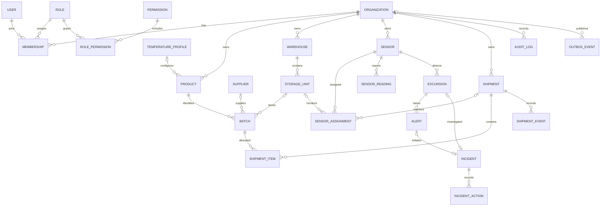

# Entity Relationship Diagram

The diagram captures the main relations defined in the current Prisma schema. Some optional relations are omitted for readability; consult `apps/api/prisma/schema.prisma` for exact columns, keys, and delete actions.

## Cardinality notes

- A `Membership` joins one user to one organization and role; permissions are resolved through role-permission mappings.
- A product can reference a temperature profile; a batch can override/select a profile and optionally occupy a storage unit.
- A sensor has readings and time-bounded assignments to a storage unit or shipment.
- A shipment has multiple batches through `ShipmentItem` and an ordered event history.
- An excursion can create an alert and can be linked to an incident; incidents retain action rows and human disposition fields.
- `AuditLog`, `OutboxEvent`, `IdempotencyRecord`, notifications and simulations provide platform/process evidence.

This is an implementation diagram, not a claim of GS1 EPCIS conformance.
