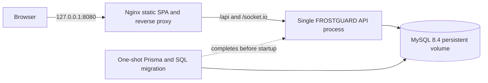

# Local Docker Compose deployment

This guide defines a reproducible local stack; it does not claim a hosted deployment or production certification. Compose validation (`docker compose config`) passed on 2026-10-31. Image build and runtime smoke remain unverified because Docker Engine is not available on the current Windows host.

## Topology



The `backend` Docker network is internal. MySQL has no host port mapping. The web port binds to loopback and can be placed behind a host-managed TLS reverse proxy. The API is deliberately one process: Socket.IO fan-out, simulation timers and outbox polling are process-local. `/health/ready` is not proxied publicly; `/health/live` is.

## Start a disposable local demo

Prerequisites: Docker Engine with Compose v2 and enough local disk for the MySQL named volume.

```powershell
Copy-Item .env.compose.example .env.compose
docker compose --env-file .env.compose config
docker compose --env-file .env.compose up --build -d
docker compose --env-file .env.compose ps
docker compose --env-file .env.compose run --rm migrate npm run db:seed -w @frostguard/api
```

Before starting, replace every `CHANGE-ME` template in `.env.compose` with distinct random values; the template is intentionally not runnable with its placeholders. Keep `.env.compose` local and out of source control.

Browse to `http://localhost:8080`. The seed creates synthetic readings and demo organizations. Sign in as `owner@northline.demo` with the `SEED_DEMO_PASSWORD` value you configured in the local env file. Do not reuse these credentials outside a disposable local instance.

The seed deletes and recreates organizations named `northline` and `meridian`. Run it only when those demo tenants contain no data you need. The database volume persists across `docker compose down`; `docker compose down -v` deletes it.

The database migration service applies committed Prisma migrations and the SQL views, triggers, procedures, constraints and indexes before API startup. On later starts, already-applied migrations are skipped and the SQL applier tolerates existing supported objects.

## Back up and restore local data

Store backups outside the repository, encrypt them, and test restores against a separate disposable database. The password is entered interactively inside the container; do not put it on the command line or commit dump files.

```powershell
$backupPath = Join-Path $env:TEMP 'frostguard-backup.sql'
docker compose --env-file .env.compose exec -T mysql sh -c 'exec mysqldump --user=root --password="$MYSQL_ROOT_PASSWORD" --single-transaction --routines --triggers frostguard' > $backupPath
```

For a restore drill, create a separate empty disposable MySQL 8.4 instance with an isolated volume and credentials. Copy the backup into that instance, then import it with the MySQL client inside that target container:

```powershell
$backupPath = Join-Path $env:TEMP 'frostguard-backup.sql'
docker cp $backupPath <disposable-mysql-container>:/tmp/frostguard-backup.sql
docker exec -it <disposable-mysql-container> mysql --user=root --password frostguard
```

At the interactive MySQL prompt run:

```sql
source /tmp/frostguard-backup.sql;
```

Do not restore over the only copy of data. These commands are operational guidance, not evidence of an executed backup/restore drill or a production recovery point objective.

## Secret rotation

For local disposable use, update `.env.compose`, recreate the API and migration containers, and rotate any application credentials that were exposed. Changing MySQL initialization variables does not change an existing database user's password; update that database user deliberately before changing `MYSQL_PASSWORD`. Production secrets belong in a managed secret store. Plan rotation for both JWT signing secrets, the telemetry HMAC secret, the MySQL app password and demo/administrative credentials. Access-token secret rotation invalidates active sessions.

The local sample is development mode so cookies work over local HTTP. For a deployed environment, use `NODE_ENV=production`, distinct unpredictable secrets, a real HTTPS public origin, TLS at a trusted edge, and restricted access to the loopback port. Never expose the sample credentials or the internal operational readiness response publicly.

## Troubleshooting

- `docker compose config` reports a missing variable: copy `.env.compose.example` and check that the selected env file is passed to every Compose command.
- MySQL stays unhealthy: inspect `docker compose logs mysql`, verify available disk and port-independent Docker health status, and keep the database volume intact while diagnosing.
- Migration fails: inspect `docker compose logs migrate`; API startup waits for migration success. Correct the cause, then rerun `docker compose --env-file .env.compose run --rm migrate`.
- API is unhealthy: inspect `docker compose logs api` and verify database readiness without printing env values.
- Browser API requests fail: confirm the web container is healthy, then inspect `docker compose logs web api`; keep the browser origin equal to `PUBLIC_ORIGIN`.
- Socket.IO does not connect through a proxy: preserve the `/socket.io/` path, HTTP/1.1 upgrade headers and a read timeout longer than the heartbeat interval.
- A host port is occupied: change `WEB_PORT` in `.env.compose`; MySQL remains unpublished.

## Scope and verification

`docker-compose.yml`, both Dockerfiles, `.dockerignore` and `apps/web/nginx.conf` were added. `docker compose --env-file .env.compose.example config` parses the definition. The Docker CLI exists, but its engine named pipe is absent; no image build, service startup, health check, migration container or browser smoke was run here. No paid service was used.

The stack is single-instance and local-first. It does not provide TLS, cloud firewall policy, managed secrets, external monitoring, backup scheduling, tested restore, shared Socket.IO adapter, independent worker, malware/image scanning, or multi-instance coordination. Do not label it production-ready based on Compose syntax alone.
